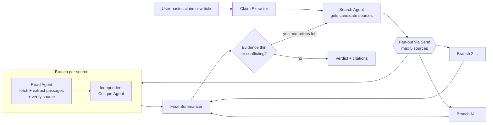
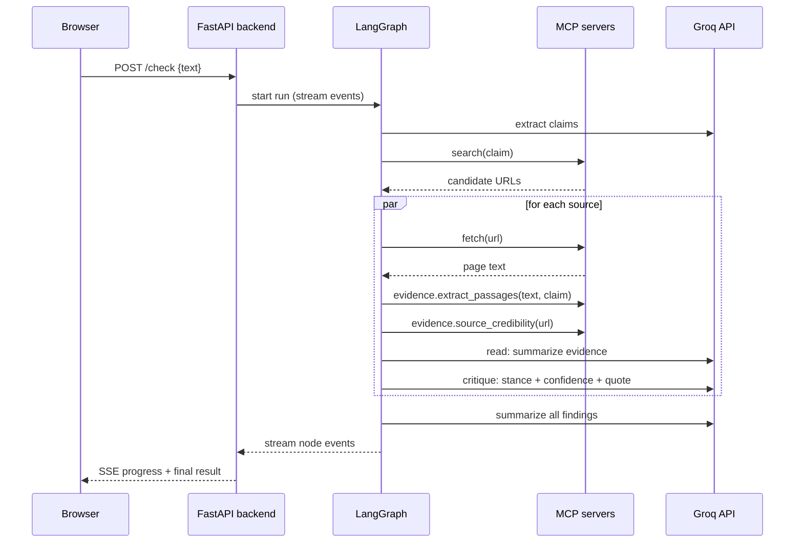
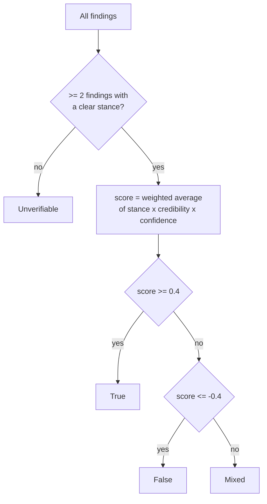
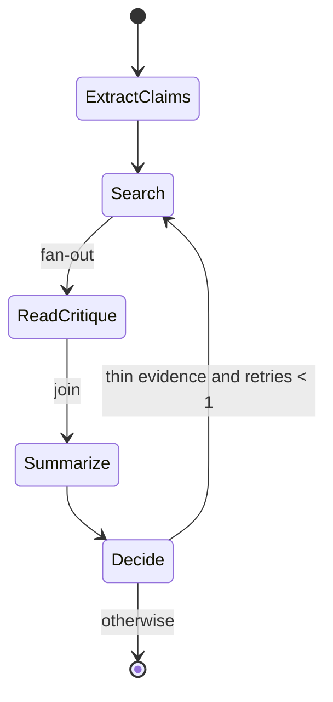
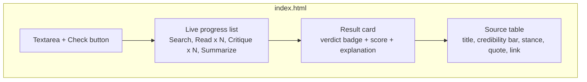
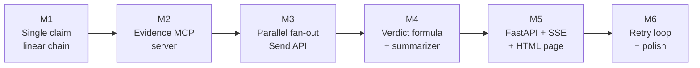

# MVP: Multi-Agent Fact-Checker (LangGraph + MCP + Groq)

> Hand this file to the coding agent. Build in the order given in **Section 12**. Do not add features outside **Section 2 (In scope)** until every acceptance check in Section 12 passes.

---

## 1. Overview

The user pastes a claim or short article into a web page. A LangGraph multi-agent pipeline extracts checkable claims, searches the web, reads each source in parallel, independently critiques each source's evidence, and produces a final verdict with citations.

The app (backend + web page) runs **locally on a laptop**. LLM calls go to the **Groq API** using its cheapest model on the free tier (see Section 3.1). No deployment. Demo only.

## 2. Scope

**In scope**
- Paste text, get a verdict per claim (True / False / Mixed / Unverifiable) with cited sources
- Parallel Read → Critique branches per source (3 to 5 sources)
- Source credibility check (deterministic rules + LLM judgment)
- One optional retry loop when evidence is thin or conflicting
- Basic HTML page served by the backend itself
- Live progress shown in the UI (which agent is running)

**Out of scope (for MVP)**
- Auth, accounts, databases, history
- Deployment, Docker, cloud anything
- Next.js or any JS framework (plain HTML + a little vanilla JS only)
- Images, video, PDFs as input
- More than 3 claims per request

## 3. Hard constraints

| Constraint | Detail |
|---|---|
| Runtime | App runs locally, demo only, no deployment |
| LLM | Groq API, free tier, model `llama-3.1-8b-instant` (cheapest, highest free limits). Key in env var `GROQ_API` |
| Orchestration | LangGraph (Python) |
| Tools | MCP servers: search, fetch, plus a **custom evidence MCP server** |
| UI | Single HTML page served by the backend (no separate frontend project) |
| Context | Small model and tight token limits: truncate and pre-filter page text before it reaches the LLM |
| Concurrency | LangGraph branches run in parallel, but LLM calls go through a semaphore (limit 2) plus rate-limit handling (Section 3.1) |

### 3.1 LLM provider: Groq

| Item | Setting |
|---|---|
| API key | Environment variable **`GROQ_API`**. Load from `.env` with `python-dotenv`. Commit a `.env.example` containing `GROQ_API=` and add `.env` to `.gitignore`. Never hardcode or log the key |
| Model | `GROQ_MODEL` env var, default **`llama-3.1-8b-instant`**. Chosen as Groq's cheapest model with the highest free-tier ceilings (about 14,400 requests/day and 500K tokens/day on the free plan as of Aug 2026). Confirm the model ID exists on Groq's models page and read the real limits at `console.groq.com/settings/limits` before the demo |
| Client | Groq Python SDK, or the OpenAI-compatible endpoint `https://api.groq.com/openai/v1` with `api_key=os.environ["GROQ_API"]`. **All LLM access lives in `app/llm.py` only**, so the model can be swapped by changing `GROQ_MODEL` |
| Settings | `temperature=0`, JSON mode for structured outputs, validate with Pydantic, one retry on invalid JSON |
| Output caps | `max_tokens`: 300 for claim extractor / read / critique, 400 for summarizer |

**Token budget (the real constraint is tokens, not requests).** A run is about 13 LLM calls (1 claim extraction, 1 query, 5 read, 5 critique, 1 summary). Keep each call near 2,500 tokens, so a run is about 30K tokens and the free daily token cap allows roughly 15 runs per day. Do not exceed 5 sources or 3 claims.

**Rate-limit handling (in `llm.py`):**
- Semaphore of 2 concurrent calls
- Read the `x-ratelimit-remaining-tokens` response header. If it is low, wait before the next call
- On HTTP 429, wait for the `retry-after` header value, then retry with exponential backoff (max 3 tries)
- If still failing, the branch returns an `unclear` finding with the note "rate limited" (never crash the run)
- Log token usage per run to the console so you can see the budget

**Small-model safeguard:** after the critique agent responds, check in plain Python that its `quote` actually appears in the passages (case-insensitive, whitespace-normalized substring or a fuzzy match). If it does not, force `stance="unclear"` and `confidence=0`. This stops the 8B model from inventing evidence.

## 4. Architecture



### Processing a multi-claim input

Claim Extractor can return up to 3 claims. The graph runs once per claim (simple loop in the API layer is fine for MVP; do not nest fan-outs).

## 5. Request lifecycle



## 6. State schema

```python
from typing import Annotated, TypedDict, Literal
import operator

class Source(TypedDict):
    url: str
    title: str
    snippet: str

class Finding(TypedDict):
    url: str
    title: str
    credibility: float                 # 0.0 to 1.0, from evidence MCP + LLM
    credibility_reason: str
    passages: list[str]                # trimmed evidence passages
    stance: Literal["supports", "contradicts", "unclear"]
    confidence: float                  # 0.0 to 1.0, from critique agent
    quote: str                         # short quote under 25 words from the page
    critique_note: str

class State(TypedDict):
    claim: str
    sources: list[Source]
    findings: Annotated[list[Finding], operator.add]   # branches append here
    retries: int
    verdict: Literal["True", "False", "Mixed", "Unverifiable"]
    score: float
    explanation: str
```

## 7. Agents

| Node | Input | Output | Notes |
|---|---|---|---|
| **claim_extractor** | raw pasted text | list of up to 3 claims | If input is already one short claim, pass it through unchanged |
| **search_agent** | claim | up to 8 sources, deduped by domain, top 5 kept | Uses search MCP. On retry, rewrites the query (see Section 10) |
| **read_agent** | claim + one source | passages, credibility, short evidence summary | Fetch, then evidence MCP trims the page to relevant passages. **Verifies source authenticity for every branch** |
| **critique_agent** | claim + passages only | stance, confidence, quote, note | **Must NOT see the read agent's summary or reasoning.** Different prompt. Structured JSON output |
| **summarizer** | all findings | verdict, score, explanation with citations | Weighted by credibility (Section 9) |

### Independence rule (important)

The critique agent receives only `{claim, passages}`. It never receives the Read agent's summary, stance guess, or credibility opinion. This is what makes it an independent check rather than a rubber stamp.

## 8. MCP servers

| Server | Source | Purpose |
|---|---|---|
| **search** | Any existing search MCP server (pick one that needs no paid API key) | `search(query)` returns titles, URLs, snippets |
| **fetch** | Existing fetch MCP server | `fetch(url)` returns page content as text/markdown |
| **evidence** (custom, build this) | Python, FastMCP | Deterministic helpers below |

### Custom evidence MCP server: tools

| Tool | Input | Output | Logic |
|---|---|---|---|
| `extract_passages` | `text`, `claim`, `max_passages=4` | list of passages | Split into chunks of about 600 chars, score by keyword overlap with claim (simple BM25 or TF-IDF is fine), return top N. Keeps LLM context small |
| `source_credibility` | `url` | `{score, reason}` | Rule-based, see Section 9 |
| `extract_date` | `text` | ISO date or null | Regex for common date patterns and meta tags |

Keep this server small. It exists so that the heavy lifting is deterministic and the small model only does judgment.

## 9. Credibility and verdict logic

### Source credibility (deterministic base, LLM adjusts by at most ±0.15)

| Signal | Effect |
|---|---|
| Domain ends in `.gov`, `.gov.in`, `.edu`, `.ac.in` | base 0.9 |
| Known reputable outlet / reference list (keep a small editable `trusted_domains.json`) | base 0.8 |
| Known fact-checking sites (keep in `fact_checkers.json`) | base 0.85 |
| Unknown domain with HTTPS | base 0.5 |
| Blog platforms, forums, social media | base 0.3 |
| Page has a publish date within 2 years | +0.05 |
| Page does not actually mention key terms of the claim | cap at 0.3 |

### Verdict

```
sign(stance) = +1 supports, -1 contradicts, 0 unclear
weight       = credibility * confidence
score        = sum(sign * weight) / sum(weight)      # range -1 to +1
```

| Condition | Verdict |
|---|---|
| fewer than 2 findings with stance != unclear | Unverifiable |
| score >= 0.4 | True |
| score <= -0.4 | False |
| otherwise (or strong credible sources on both sides) | Mixed |

The summarizer LLM writes the explanation, but **the verdict comes from this formula, not from the LLM.**



## 10. Retry loop (single retry max)

After the summarizer, a conditional edge checks:

- verdict is Unverifiable, **or**
- verdict is Mixed and total credible findings (credibility >= 0.6) is fewer than 2

If true and `retries < 1`: increment `retries`, ask the LLM for a refined search query (rephrase, add "fact check", add key entities), and go back to `search_agent`. Keep old findings and append new ones. Otherwise finish.



## 11. Backend and UI

### Backend (Python)

- FastAPI app, run with `uvicorn`
- `GET /` serves `static/index.html`
- `POST /check` body `{ "text": "..." }`, returns a Server-Sent Events stream
- LangGraph `astream_events` or `stream_mode="updates"` is mapped to SSE messages
- MCP clients connected via `langchain-mcp-adapters` (or the official MCP Python SDK)
- All three MCP servers launched over stdio at startup

### SSE event shapes

```json
{"type": "progress", "node": "read_agent", "detail": "Reading example.com"}
{"type": "finding", "finding": { "...Finding object..." }}
{"type": "result", "claim": "...", "verdict": "Mixed", "score": 0.12, "explanation": "...", "findings": []}
{"type": "error", "message": "..."}
```

### UI (single `static/index.html`, vanilla JS, no build step)



Verdict badge colors: True green, False red, Mixed amber, Unverifiable grey. Keep styling minimal and clean.

## 12. Build order and acceptance checks

Build in this order. Do not move on until the check passes.



| # | Milestone | Acceptance check |
|---|---|---|
| **M1** | CLI script: one claim to Search (MCP) to ONE Read to ONE Critique to print result. Groq via `llm.py` working with `GROQ_API`, JSON output validated with Pydantic, one retry on bad JSON | `python cli.py "The Great Wall of China is visible from space"` prints a finding with stance and quote |
| **M2** | Custom evidence MCP server with `extract_passages`, `source_credibility`, `extract_date`. Wire into Read agent | Passages sent to the LLM are under 1,200 tokens per source. Credibility returns sensible values for a .gov, a Wikipedia, and a random blog URL |
| **M3** | Fan-out with `Send` (max 5), `findings` reducer using `operator.add`, semaphore of 2 plus 429 / `retry-after` handling in `llm.py` | 5 sources processed, all findings present in final state, no crash if one fetch fails (that branch returns an `unclear` finding with a note) |
| **M4** | Verdict formula (Section 9) in plain Python plus summarizer LLM writing the explanation | Unit tests for the formula with fake findings (all support gives True, all contradict gives False, split gives Mixed, under 2 clear gives Unverifiable) |
| **M5** | FastAPI, `/check` SSE, `index.html` with live progress and result view | Paste a claim in the browser and see progress update live, then the verdict card and source table |
| **M6** | Retry loop, up to 3 claims per input, error states in UI, README with run steps | A vague claim triggers exactly one retry. Input over 3 claims shows the first 3 with a notice |

## 13. Error handling rules

- Fetch fails or times out (10s): branch returns a Finding with `stance="unclear"`, `confidence=0`, and a note. Never crash the run.
- LLM returns invalid JSON: retry once with a stricter reminder, then fall back to `unclear`.
- Groq returns 429 or times out: follow the backoff rules in Section 3.1, then fall back to `unclear` with a "rate limited" note.
- Missing `GROQ_API`: fail at startup with a clear message, before any request is accepted.
- Critique quote not found in the passages: force `unclear` (Section 3.1).
- Search returns fewer than 2 sources: skip fan-out, verdict is Unverifiable with an explanation.
- Page text is empty or paywalled: credibility capped at 0.3, stance `unclear`.
- Total run budget: abort with a partial result after 3 minutes.

## 14. Project structure

```
factchecker/
├── MVP.md
├── README.md
├── requirements.txt
├── .env.example           # GROQ_API=
├── .gitignore             # includes .env
├── trusted_domains.json
├── fact_checkers.json
├── app/
│   ├── main.py            # FastAPI + SSE
│   ├── graph.py           # LangGraph definition
│   ├── nodes.py           # claim_extractor, search, read, critique, summarize
│   ├── state.py           # State, Finding, Source
│   ├── verdict.py         # pure-Python scoring (unit tested)
│   ├── llm.py             # Groq client (GROQ_API, GROQ_MODEL), semaphore, rate limits, JSON validation
│   ├── mcp_client.py      # connects search, fetch, evidence servers
│   └── prompts.py         # all prompts in one place
├── mcp_servers/
│   └── evidence_server.py # custom FastMCP server
├── static/
│   └── index.html
└── tests/
    └── test_verdict.py
```

## 15. Prompts (guidelines, not final text)

- **Read agent:** "Given this claim and these passages, summarize only what the passages say that is relevant. Do not judge truth. If the passages are unrelated, say so."
- **Critique agent:** "You are an independent fact-checker. Using ONLY the passages, decide if they support, contradict, or are unclear about the claim. Output JSON: `stance`, `confidence` (0 to 1), `quote` (under 25 words, copied from the passages), `note`. If you cannot find a supporting quote, stance must be `unclear`."
- **Summarizer:** "Write a 3 to 5 sentence explanation of the verdict below. Cite sources as [1], [2]. Mention disagreement between sources if any. Do not change the verdict."

All prompts must request JSON where structured, and keep inputs short for the small model.

## 16. Demo test claims

| Claim | Expected |
|---|---|
| "The Great Wall of China is visible from space with the naked eye" | False |
| "Water boils at 100 degrees Celsius at sea level" | True |
| "Drinking eight glasses of water a day is required for good health" | Mixed |
| "A completely made-up statement with invented names" | Unverifiable |

## 17. Stretch (only after M6)

- Show a small graph visualization of the run in the UI
- Human-in-the-loop `interrupt` before retry, asking the user to approve the refined query
- Export the result as Markdown
- LangGraph checkpointer (SQLite) so runs can be replayed

## 18. Definition of done

- All six milestones pass their acceptance checks
- `README.md` has setup (install, set `GROQ_API`, run) in under 10 lines
- Runs locally with only Groq, search and fetch calls going out; `GROQ_API` is read from env and never committed
- Demo test claims in Section 16 behave as expected
