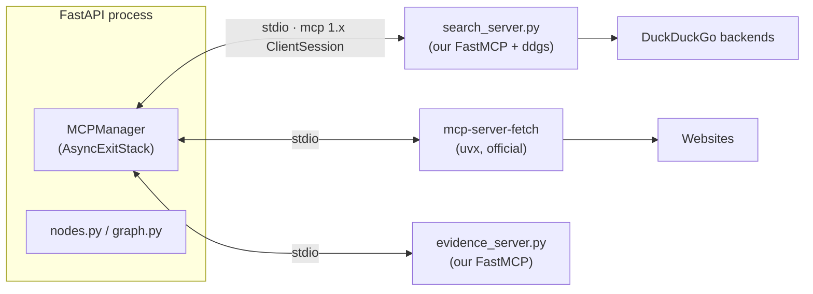

# Tool-MCP Reference

How this project uses the Model Context Protocol: three servers over stdio, one client (`app/mcp_client.py`), launched once at app startup.

## 1. Wiring



- **Transport**: stdio; servers are subprocesses of the backend, started in `MCPManager.__aenter__` and torn down LIFO via `AsyncExitStack` (hand-managed `__aenter__/__aexit__` caused anyio "cancel scope" crashes — do not regress).
- **SDK**: `mcp>=1.17,<2` pinned in `requirements.txt`. mcp 2.x renamed FastMCP → `MCPServer` with breaking changes; the spec targets FastMCP.
- **No** `langchain-mcp-adapters` — the official SDK is sufficient and is what the spec allows.

## 2. The three servers

| Server | Source | Run command (as launched by MCPManager) | Purpose |
|---|---|---|---|
| **search** | ours: `mcp_servers/search_server.py` | `<mini python> mcp_servers/search_server.py` | keyless web search |
| **fetch** | official PyPI package | `uvx mcp-server-fetch` | URL → page text |
| **evidence** | ours: `mcp_servers/evidence_server.py` | `<mini python> mcp_servers/evidence_server.py` | deterministic passage/credibility/date helpers |

Why search is ours: the npm `duckduckgo-mcp-server` triggers DuckDuckGo anomaly detection from this network ("DDG detected an anomaly"). We wrap the `ddgs` Python lib instead (also keyless). Free engines are flaky (brave 429, google 403 observed), so the tool retries up to 3 times with 2s/4s waits.

### search server — tool `search`

```
search(query: str, max_results: int = 8) -> str
```

Returns text blocks separated by `---` lines:

```
Title: Boiling point - Wikipedia
URL: https://en.wikipedia.org/wiki/Boiling_point
Snippet: Because of this, water boils at 100 °C...
---
Title: ...
```

Errors come back as `Error: ...` text (client maps that to `[]`).

### fetch server — tool `fetch`

```
fetch(url: str, max_length: int) -> str
```

Called with `max_length=10000` by `MCPManager.fetch_page`. Honors robots.txt (404 on robots → proceeds; respects disallow). Respects Readability/Python extraction fallbacks; degrades gracefully on JS-heavy pages.

### evidence server — tools

All heavy lifting is deterministic on purpose: the small model only judges.

| Tool | Signature | Logic |
|---|---|---|
| `extract_passages` | `(text, claim, max_passages=4) -> list[str]` | sentence-aware ~600-char chunks (hard-split fallback for punctuation-less text), scored by claim-keyword hits + coverage bonus, top N |
| `source_credibility` | `(url) -> {score, reason}` | rule tiers below |
| `extract_date` | `(text) -> str \| null` | `<meta>`/`<time>` tags first, then ISO / US / EU / slash regexes → ISO `YYYY-MM-DD` |

**Credibility tiers** (in `evidence_core.source_credibility`):

| Rule | Score |
|---|---|
| `.gov` / `.mil` / `.gov.in` / `.ac.in` / `.edu` | 0.9 |
| in `fact_checkers.json` (snopes, politifact, factcheck.org, …) | 0.85 (checked first — beats trusted) |
| in `trusted_domains.json` (wikipedia, reuters, nasa, …) | 0.8 |
| blog / forum / social platform (hardcoded set) | 0.3 |
| unknown + HTTPS | 0.5 |
| unknown without HTTPS | 0.4 (spec-silent case; documented choice) |
| invalid URL | 0.0 |

**Pure helpers in `evidence_core.py`** (imported directly by `app/nodes.py`, unit-tested without starting the server):

- `quote_in_passages(quote, passages, fuzzy_threshold=0.9)` — case/whitespace-normalized substring or difflib fuzzy window (≥0.9), min length 10. The safeguard that forces `stance="unclear"` when the critique model invents quotes.
- `is_recent(iso, within_years=2)` — powers the +0.05 recency bonus.
- `claim_keywords(claim)` — stopword-filtered keyword list; pages missing all claim terms get credibility capped at 0.3.

## 3. Client side (`MCPManager`)

```python
async with MCPManager() as mcp:
    sources  = await mcp.search_web(query)          # → list[{url,title,snippet}] (parsed, domain-deduped separately)
    text     = await mcp.fetch_page(url)            # → str
    passages = await mcp.extract_passages(text, claim)  # → list[str]
    cred     = await mcp.source_credibility(url)    # → {score, reason}
    date     = await mcp.extract_date(page_text)    # → str | None
```

- Response parsing is **shape-tolerant**: FastMCP 1.x is inconsistent between `structuredContent.result` (lists/strings) and `content[0].text` (dicts are JSON, lists are NOT JSON) — every helper checks both and degrades to safe defaults.
- Domain dedup (`dedupe_by_domain`) lives client-side in `mcp_client.py`.

## 4. Adding a new tool

1. Pure logic goes in `mcp_servers/evidence_core.py` (or a sibling `*_core.py`) so it is unit-testable offline.
2. Wrap it in the server with `@mcp.tool()` — **never shadow the imported function name** (caused a RecursionError once: the tool called itself).
3. Add a typed helper on `MCPManager` that handles both response shapes.
4. Add offline tests in `tests/` and, if it needs the wire, extend `samples/smoke_evidence.py`.

## 5. Smoke tests (no Groq calls)

```powershell
& "C:\Users\IC1807\anaconda3\envs\mini\python.exe" samples\smoke_mcp.py       # search + fetch over MCP
& "C:\Users\IC1807\anaconda3\envs\mini\python.exe" samples\smoke_evidence.py  # all 3 evidence tools via MCPManager
```
