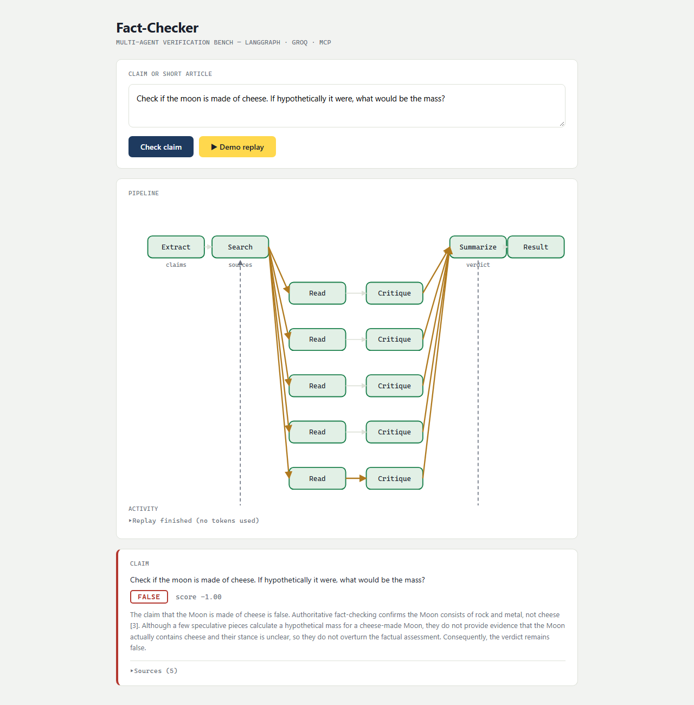
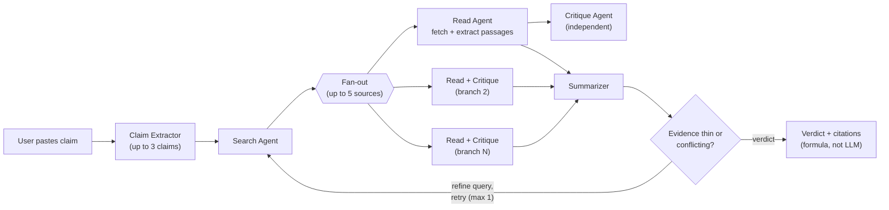

# Multi-Agent Fact-Checker

Paste a claim or short article, get a verdict — **True / False / Mixed / Unverifiable** — with cited sources. A LangGraph multi-agent pipeline extracts claims, searches the web, reads and **independently critiques** every source in parallel, and weighs the evidence into a verdict. Runs locally; LLM calls go to Groq's free tier.



## How it works



Key design rules:

- **The verdict comes from a plain-Python formula** (credibility × confidence weighted stance score); the LLM only writes the prose explanation.
- **The critique agent never sees the read agent's summary** — only the claim and the raw passages — so it's a genuine independent check, not a rubber stamp.
- **Every tool that can be deterministic is deterministic**: an in-house MCP server does passage extraction, source credibility tiers, and date parsing so the small LLM only judges.
- One optional retry loop: if evidence is thin, the search query is rewritten and fresh sources are fan-out-checked once more.

Full architecture (11 diagrams): [`Docs/architecture.md`](Docs/architecture.md) · MCP server details: [`Docs/Tool-MCP.md`](Docs/Tool-MCP.md) · Spec + build deviations: [`Docs/MVP.md`](Docs/MVP.md) · Build logs: [`Docs/reports/`](Docs/reports/)

## Prerequisites

- **Python 3.12** (developed on conda env `mini`; any 3.12+ venv works)
- **A Groq API key** — free tier is enough ([console.groq.com/keys](https://console.groq.com/keys))
- **[uv](https://docs.astral.sh/uv/)** — the page-fetch MCP server is launched through `uvx mcp-server-fetch` at backend startup; install uv first or the server won't start

## Setup

```powershell
git clone https://github.com/SaiGuruInukurthi/Agentic-AI-mini-project-.git
cd Agentic-AI-mini-project-
pip install -r requirements.txt
copy .env.example .env    # then put your key in GROQ_API=...
```

`.env` supports model overrides (defaults: `gpt-oss-20b` for per-source read/critique, `gpt-oss-120b` for extraction/query-rewrite/summarizing, `qwen3.8-27b` as automatic fallback — each model has its own free-tier token bucket):

```
GROQ_API=gsk_...
GROQ_MODEL=openai/gpt-oss-20b
GROQ_MODEL_BIG=openai/gpt-oss-120b
GROQ_MODEL_FALLBACK=qwen/qwen3.8-27b
```

## Run

CLI (one claim → verdict):

```powershell
python cli.py "The Great Wall of China is visible from space"
```

Web UI:

```powershell
python -m uvicorn app.main:app
# open http://127.0.0.1:8000
```

Paste a claim and press **Check claim** — live progress streams per source (pipeline graph above updates in real time), then each claim gets a result card with a collapsible **Sources** table (linked URLs, stance, credibility bar, supporting quote).

**▶ Demo replay** replays the most recent recorded run from `logs/` through the same UI with **zero tokens** — useful for demos and UI work without touching the API budget.

## Tests

76 offline tests, no API calls:

```powershell
python -m pytest tests -q
```

## Troubleshooting

See [`Docs/startup.md`](Docs/startup.md) — covers 404 model retirement, `401 expired_api_key`, DDG anomaly detection, console encoding, and MCP startup timing.

## License

[MIT](LICENSE)
