# Architecture

All diagrams are Mermaid and reflect the code as built (M1–M6). The LangGraph structure and its retry cycle are in [Section 5](#5-langgraph-structure--cycle-the-core).

## 1. System context (who talks to what)

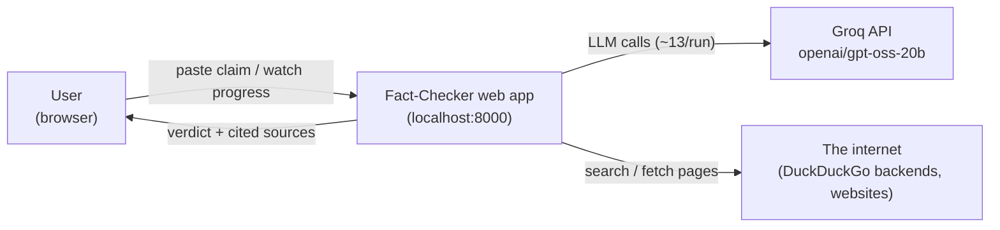

## 2. Container / deployment view (processes on the laptop)

Everything runs locally; only outbound HTTPS leaves the machine.

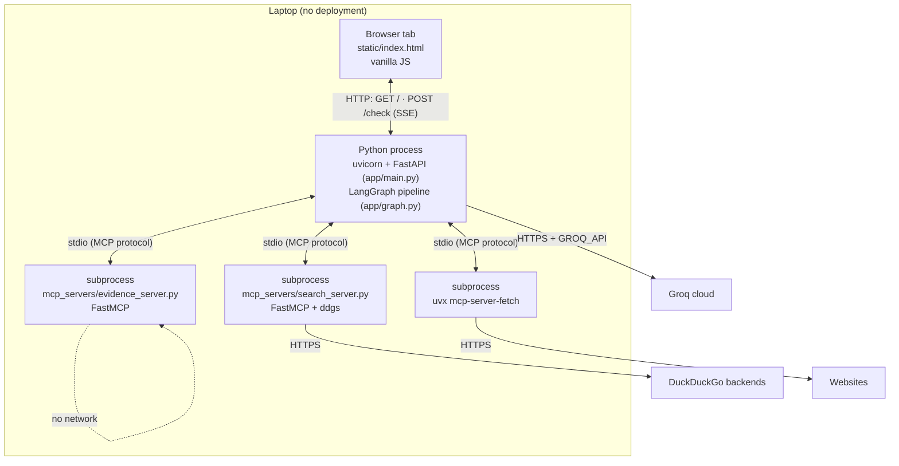

MCP servers start once at app startup (lifespan in `app/main.py`), not per request.

## 3. Component view (code modules)

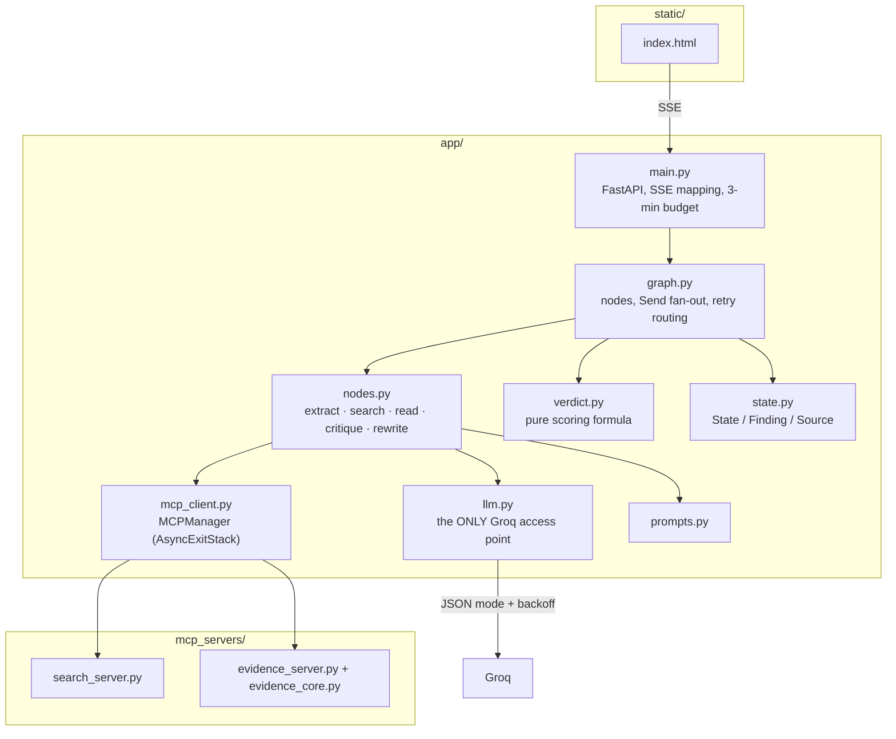

## 4. Layered view

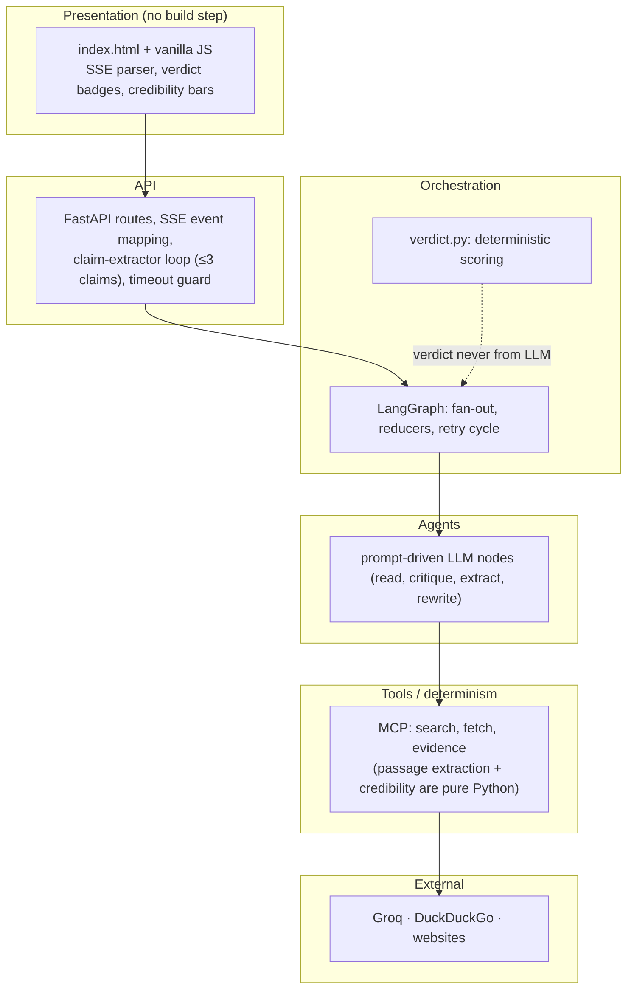

## 5. LangGraph structure & cycle (the core)

Compiled by `build_graph(mcp, client)` in `app/graph.py`. State flows through typed channels; `findings` uses the `operator.add` reducer so parallel branches append.

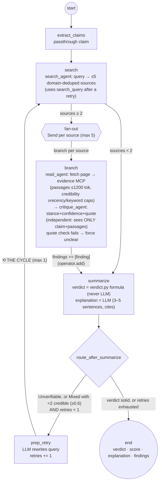

Runtime lifecycle of one claim run:

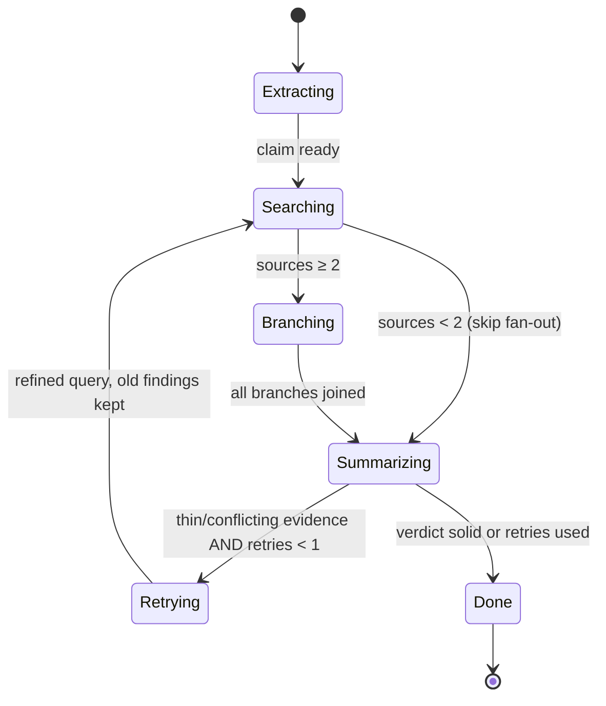

## 6. Request lifecycle (sequence)

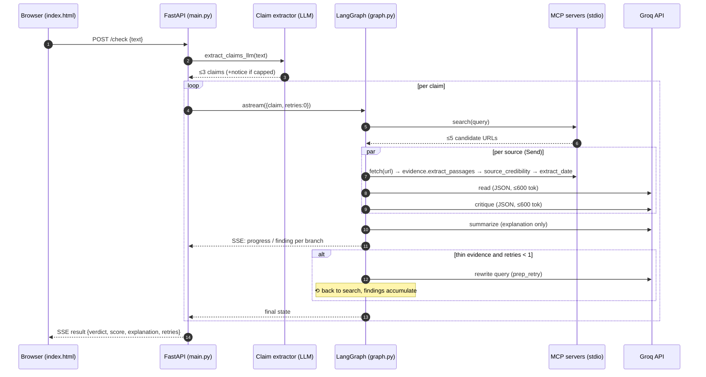

## 7. Data flow (DFD-style)

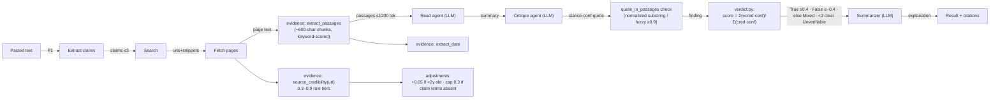

## 8. Data model (class view)

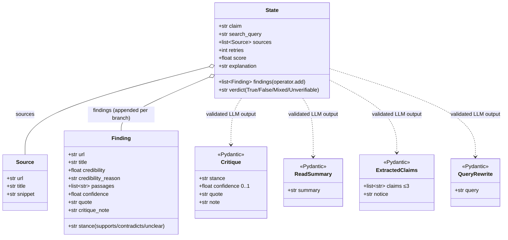

## 9. Logical data relationships (ER view)

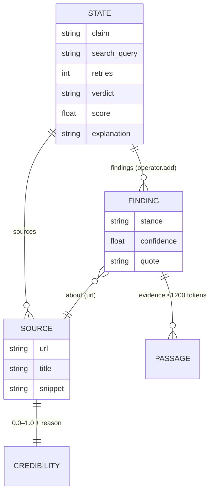

## 10. SSE event protocol (message flow)

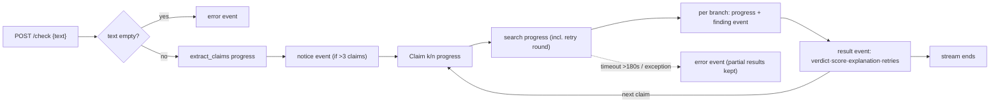

Event shapes (spec Section 11):

| type | payload |
|---|---|
| `progress` | `{node, detail}` |
| `finding` | `{finding: Finding}` |
| `notice` | `{message}` (claim cap) |
| `result` | `{claim, verdict, score, explanation, findings, retries}` |
| `error` | `{message}` |

## 11. Build history (git)

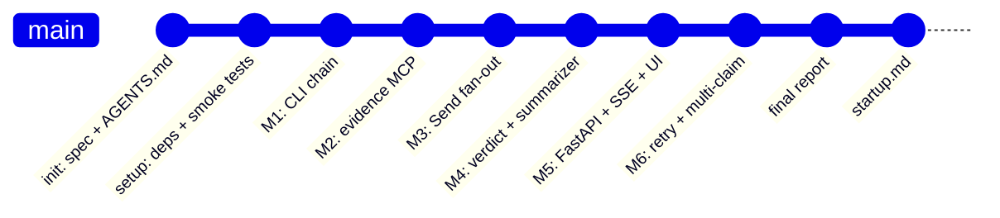

## 12. Reliability architecture (cross-cutting)

| Concern | Mechanism | Where |
|---|---|---|
| Runaway LLM spend | semaphore(2), remaining-tokens pause, 429 retry-after backoff (max 3), per-run usage log | `app/llm.py` |
| Invented evidence | quote-in-passages check → force `unclear`, confidence 0 | `app/nodes.py` + `evidence_core.py` |
| Verdict integrity | formula in plain Python; LLM only writes prose | `app/verdict.py` |
| Dead sources | fetch failure → branch returns `unclear` finding, run never crashes | `app/graph.py`, `app/nodes.py` |
| Bad JSON | 1 stricter-JSON retry, then `unclear` fallback | `app/llm.py` |
| Flaky search | 3-attempt capped retry inside search tool | `mcp_servers/search_server.py` |
| Runaway runtime | 180s budget → error event with partial results | `app/main.py` |
| Missing key | fail fast at startup | `app/main.py` lifespan |
